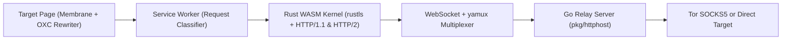

# ZeroProxy

ZeroProxy is an isolation web proxy written in Rust, JavaScript, and Go. It runs untrusted websites inside a virtualized browser tab while terminating TLS and framing HTTP/1.1 and HTTP/2 on the client inside a WebAssembly Service Worker kernel. The Go server acts as an untrusted byte relay that forwards encrypted streams to a SOCKS5 upstream (such as Tor with per-tab stream isolation) or a direct network connection.

ZeroProxy is structured as a set of embeddable Go packages, Rust transformation and transport crates, and a frozen browser runtime surface, backed by a standalone CLI server (`cmd/zeroproxy-server`).

## Architecture

Client-side rewrite, policy, and TLS state live in the browser tab and Service Worker. The Go relay forwards opaque byte streams without holding target URL keys or terminating target TLS sessions.



1. **Client-side route encryption:** The launcher encrypts the target URL into `/zp/p/<ciphertext>#k=<key>&server=...`. The AES-256-CBC and HMAC-SHA256 keys are derived with HKDF from the `#k=` URL fragment, which the browser never sends over HTTP.
2. **Service Worker request interception:** The Service Worker classifies every fetch and routes target traffic into the Rust WebAssembly transport kernel (`zp-kernel.wasm`), which negotiates TLS via `rustls` and speaks HTTP/1.1 or HTTP/2 over a multiplexed `yamux` WebSocket tunnel (`/zp/ws-pipe`).
3. **HTML, CSS, and JS transformation:** Before responses reach the page, `zp-engine` rewrites HTML documents (`lol_html`), CSS stylesheets (`swc_css_parser`), and JavaScript ASTs (`oxc`) so accesses to `window`, `location`, `document`, and dynamic code evaluation pass through the page membrane.
4. **Per-site storage and circuit isolation:** The browser membrane partitions `localStorage`, `sessionStorage`, IndexedDB, Cache Storage, BroadcastChannel, OPFS, and cookies by virtual origin. When paired with Tor, each tab authenticates to SOCKS5 with distinct credentials so tabs do not share circuits.

## Library Packages and Embedding

Each layer exposes an explicit public contract so host applications can embed the Go relay, the Rust rewrite and dialer engines, or the browser runtime independently.

### Go Packages (`github.com/gosuda/zeroproxy/pkg/...`)

- **[`pkg/httphost`](pkg/httphost):** Mounts the `/zp/*` HTTP handler and `/zp/ws-pipe` relay into any `net/http` server. `NewServer(cfg Config) (*Server, error)` validates `Transport` (`TransportAuto`, `TransportSOCKS5`, `TransportDirect`) and `TargetPolicy` (`TargetPolicyDefault`, `TargetPolicyAllowPrivate`, `TargetPolicyBlockPrivate`) at construction time and returns a `*Server` implementing `http.Handler` and `io.Closer`.
- **[`pkg/wtproxy`](pkg/wtproxy):** Optional HTTP/3 WebTransport datagram and stream relay mounted at `/zp/wt`. Constructed via `wtproxy.New(cfg Config) (*Listener, error)`.
- **[`pkg/rtcgw`](pkg/rtcgw):** Optional ephemeral-credential TURN server (`rtcgw.NewTURNServer`) and `501 RTC_GATEWAY_UNAVAILABLE` signaling stub (`rtcgw.Handler`) for relay-only WebRTC media.

```go
package main

import (
	"log"
	"net/http"

	"github.com/gosuda/zeroproxy/pkg/httphost"
)

func main() {
	srv, err := httphost.NewServer(httphost.Config{
		WebDir:       "dist/web",
		Transport:    httphost.TransportSOCKS5,
		SocksAddr:    "127.0.0.1:9050",
		TargetPolicy: httphost.TargetPolicyBlockPrivate,
	})
	if err != nil {
		log.Fatal(err)
	}
	defer srv.Close()

	log.Fatal(http.ListenAndServe(":8080", srv))
}
```

### Rust Crates (`crates/*`)

- **[`crates/zp-engine`](crates/zp-engine):** Host-targetable facade over JavaScript AST rewriting, streaming HTML transformation, CSS rewriting, and source map composition. Uses a single typed `ScriptKind` enum (`Classic`, `Module`, `Inline`, `Eval`, `EventHandler`) across `TransformEngine::rewrite_script`, `rewrite_script_patches_json`, `compose_source_map`, and `compose_source_map_chained`; string parsing stays at the WebAssembly boundary via `parse_script_kind`.
- **[`crates/zp-css`](crates/zp-css):** Rewrites `url(...)` and `@import` specifiers in stylesheets via `rewrite_css(source, base_url, control_prefix, proxy_origin) -> Result<CssRewriteOutput, CssError>`.
- **[`crates/zp-kernel-bundle`](crates/zp-kernel-bundle):** Browser transport kernel. Its host-portable dialer contract lives in [`zp_kernel_bundle::dial`](crates/zp-kernel-bundle/src/dial.rs) (`Dialer`, `AsyncIo`, `TargetAddr`, `DialError`, `set_dialer`, `clear_dialer`, `injected_dialer`) and compiles on non-WASM targets; the default `RelayDialer` in `kernel::transport::dialer` is `wasm32`-only.
- **[`crates/zp-page-rt`](crates/zp-page-rt):** Zero-dependency `no_std` WebAssembly runtime (`zp-rt.wasm`) backing synchronous URL interning and classification in the page membrane. Packs a 4-bit class and 28-bit handle (`(class << 28) | handle`) in `bulk_intern_and_classify`.

```rust
use zp_engine::{DocCtx, ScriptKind, TransformEngine};

let mut engine = TransformEngine::new();
let ctx = DocCtx::new("https://example.com/index.html", "http://proxy.localhost:8080");

let rewritten_js = engine.rewrite_script(
    "const href = window.location.href;",
    ScriptKind::Module,
    &ctx,
)?;

let rewritten_html = engine.transform_html(
    "<!doctype html><a href=\"/docs\">Docs</a>",
    &ctx,
)?;
# Ok::<(), zp_engine::EngineError>(())
```

### JavaScript and Browser Runtime (`web/*`)

- **[`web/zp-core.js`](web/zp-core.js) and [`web/zp-core.d.ts`](web/zp-core.d.ts):** Freeze `globalThis.ZP` as the public browser runtime contract (URL classification, share URL encryption, binary v2 envelope encoding/decoding, and host bridge installation via `ZP.configureBridge`). Internal helpers are passed to first-party bundles through `globalThis.__zp_internal`, which consumers capture into a closure and delete from `globalThis`.
- **`window.__zp_realm` (`ZPRealmHandle`):** Frozen per-document handle created by [`web/membrane/`](web/membrane) exposing `tabId`, `entryId`, `getVirtualURL()`, `getBaseURL()`, `setBridge(bridge)`, and `dispose()`.

```js
// Install an optional host bridge in the page realm
window.__zp_realm.setBridge({
  classifyUrl(rawUrl, baseUrl) {
    return null; // Return null to fall back to the default classifier
  },
  onNavigate(nextVirtualUrl) {
    console.log("Virtual navigation:", nextVirtualUrl);
  },
});
```

## `/zp/*` Wire Contract

All proxy traffic and static assets stay under `/zp/*`. Retired legacy routes (`/zp/api/fetch`, `/p/*`, `/sw.js`, `/index.html`, `/__zp/*`, `/zp/assets/*`, `/zp/api/sourcemap`, `/zp/api/rtc/signal`) return `403 POLICY_BLOCKED`.

| Path | Method | Purpose |
| :--- | :--- | :--- |
| `/zp/`, `/zp/index.html` | `GET` | Launcher UI (`web/index.html`). |
| `/zp/sw.js` | `GET` | Service Worker script (`Service-Worker-Allowed: /zp/`). |
| `/zp/Asset/<name>` | `GET` | Allowlisted static and WASM assets (`zp-core.js`, `runtime-prelude.js`, `worker-prelude.js`, `zp-page-bundle.js`, `zp-bundle.js`, `zp-bundle.wasm`, `zp-kernel.js`, `zp-kernel.wasm`, `zp-rt.wasm`, `favicon.ico`, `manifest.webmanifest`). |
| `/zp/p/<opaque>` | `GET` | Encrypted target navigation route handled by the Service Worker; returns a minimal bootstrap shell on cold load. |
| `/zp/ws-pipe` | `GET` (`Upgrade: websocket`) | Multiplexed `yamux` + SOCKS5 byte pipe (`Sec-WebSocket-Protocol: zp-yamux-v1`). |
| `/zp/api/v2/fetch` | `POST`, `GET` | Direct-mode fetch fallback using the v2 binary envelope (`[u32 LE head length][JSON head][raw body]`, `application/zp-envelope`). Disabled in relay mode. |
| `/zp/api/sync-fetch`, `/poll`, `/result` | `GET`, `POST` | Synchronous XHR rendezvous between page worker, Go server, and Service Worker. |
| `/zp/api/sourcemaps` | `GET` | Chained source map lookup (`?u=<target>&k=<kind>`). |
| `/zp/wt` | `CONNECT` (HTTP/3) | Optional WebTransport relay endpoint. |
| `/zp/rtc/turn-credentials` | `GET` | Issues short-lived HMAC-SHA1 TURN credentials when the TURN gateway is enabled. |
| `/zp/rtc/offer` | `*` | Reserved WHIP/WHEP stub (`501 RTC_GATEWAY_UNAVAILABLE`). |
| `/zp/healthz` | `GET` | Health probe returning `{"ok":true}`. |

## Standalone Server Quickstart

### Prerequisites

- **Rust** with the `wasm32-unknown-unknown` target defined in [`rust-toolchain.toml`](rust-toolchain.toml).
- **`wasm-bindgen-cli`** matching the `wasm-bindgen` version pinned in [`Cargo.lock`](Cargo.lock).
- **Go** matching [`go.mod`](go.mod), **Node.js LTS**, and **npm**.
- **A Chromium or Firefox browser** with Service Worker and WebAssembly support.
- **Tor** (optional), required when running with anonymous egress and per-tab stream isolation.

### 1. Build the Server and Browser Assets

> [!WARNING]
> Confirm that Rust, `wasm-bindgen-cli`, and Go are installed before running `npm run build` on a machine that already has a working `dist/` directory. The build script cleans `dist/` before compiling and will remove your runnable bundle if a required compiler is missing.

```sh
npm ci
npm run build
```

This compiles the Go server binary and WebAssembly bundles into `dist/`:

```text
dist/zeroproxy-server                  Go relay server (.exe on Windows)
dist/web/                              Built browser assets served to clients
dist/web/Asset/zp-bundle.wasm          Service Worker HTML/CSS/JS rewrite bundle
dist/web/Asset/zp-kernel.wasm          Lazily loaded transport kernel (yamux, SOCKS5, rustls, HTTP)
dist/web/Asset/zp-page-bundle.js       Page-realm dynamic script rewriter (WASM inlined)
dist/web/Asset/zp-rt.wasm              Raw WASM runtime for synchronous URL policy checks
```

### 2. Start the Relay Server

> [!CAUTION]
> Do not use `-socks internal` when you need network anonymity. In internal mode, the Go relay dials target servers directly from the host machine's IP address. Use an external Tor SOCKS5 listener with `IsolateSOCKSAuth` whenever anonymity matters.

> [!IMPORTANT]
> Always pass `-web dist/web` to the server. Passing the source `-web web` directory causes HTTP `503` errors because the compiled WebAssembly bundles exist only under `dist/web/Asset/`.

**Option A: Local compatibility test mode (direct connection, no Tor)**

```sh
./dist/zeroproxy-server -web dist/web -addr :8080 -socks internal
```

**Option B: Anonymous browsing through Tor**

Start a local Tor SOCKS5 listener with stream isolation enabled:

```sh
mkdir -p /tmp/zeroproxy-tor
tor --SocksPort "127.0.0.1:9050 IsolateSOCKSAuth" --DataDirectory /tmp/zeroproxy-tor
```

Once Tor prints `Bootstrapped 100% (done)`, start the relay:

```sh
./dist/zeroproxy-server -web dist/web -addr :8080 -socks 127.0.0.1:9050
```

### 3. Open the Launcher

Open **`http://proxy.localhost:8080/zp/`** in your browser, enter a target URL, and press **Open**. Using `proxy.localhost` keeps the launcher, the Service Worker, and all encrypted target routes on a single secure-context origin.

## Containment Guarantees

- **No direct network egress:** Content Security Policy headers and membrane hooks route all HTTP fetches, XMLHttpRequests, WebSockets, EventSources, beacons, and subresources through the Service Worker and relay tunnel. Optional WebTransport (`/zp/wt`) and WebRTC TURN relays are disabled by default.
- **No access to the real browser realm:** Target scripts never receive the real `window`, `Location`, or an uncontained iframe realm. Cross-origin frames and popups receive filtered membrane wrappers that enforce HTML cross-origin access rules across virtual origins.
- **Per-site storage partitioning:** Even though proxied tabs share the physical `proxy.localhost` browser origin, the membrane namespaces cookies, `localStorage`, `sessionStorage`, IndexedDB, Cache Storage, BroadcastChannel, and Origin Private File System directories by virtual origin.
- **Fail-closed script and HTML transformation:** Every executable script passes through the Rust OXC AST rewriter before running. If a script or HTML document cannot be rewritten safely, ZeroProxy blocks execution and renders an isolated error page.
- **Client-held URL keys:** Target URLs are encrypted with AES-256-CBC and authenticated with HMAC-SHA256 using HKDF-derived keys kept in the client-only URL `#` fragment.

## Verification and Testing Commands

On machines with limited RAM, prefer pushing branches to the [GitHub Actions CI workflow](.github/workflows/ci.yml) rather than running parallel local Rust builds and headless browsers.

| Check | Command | What It Verifies |
| :--- | :--- | :--- |
| **JavaScript unit and policy suite** | `npm run test:js` | Node.js checks for URL policy, Service Worker routing, `globalThis.ZP` contract, and membrane invariants. |
| **Rust workspace tests** | `cargo test --workspace` | Unit and property tests for OXC AST rewriting, HTML/CSS transforms, dialer contracts, share URL encryption, and codecs. |
| **Go server and host tests** | `go test ./...` | `pkg/httphost`, `pkg/wtproxy`, `pkg/rtcgw`, relay bridging, SOCKS5 framing, CSP headers, and route guards. |
| **WASM bundle integration** | `npm run test:wasm:ci` | Contract checks against prebuilt WebAssembly artifacts in `dist/`. |
| **Browser end-to-end suite** | `npm run test:e2e:ci` | Real Chromium E2E tests against `dist/`, including the containment escape matrix and native-vs-proxy differential checks. |
| **TLS ClientHello check** | `npm run check:chrome-hello` | Verifies that the Rust kernel's TLS ClientHello matches the installed Chrome browser's extension set and `trust_anchors` payload. |
| **Real-site smoke test (opt-in)** | `npm run dogfood:real-site` | Launches a fresh Chromium profile and loads live external sites through the proxy ([`test/e2e/real-site-regression.test.js`](test/e2e/real-site-regression.test.js)). |

## Repository Map

| Path | Responsibility |
| :--- | :--- |
| [`pkg/httphost`](pkg/httphost), [`pkg/wtproxy`](pkg/wtproxy), [`pkg/rtcgw`](pkg/rtcgw) | Public embeddable Go packages for the `/zp/*` HTTP host, WebTransport relay, and WebRTC TURN gateway. |
| [`cmd/zeroproxy-server`](cmd/zeroproxy-server), [`internal/`](internal) | Standalone Go CLI server and internal HTTP, WebSocket, SOCKS5, WebTransport, and TURN implementations. |
| [`crates/zp-engine`](crates/zp-engine) | Unified Rust facade over script rewriting, streaming HTML transformation, CSS rewriting, and source map composition. |
| [`crates/zp-bundle`](crates/zp-bundle) | Service Worker WebAssembly exports (`zp-bundle.wasm`) wrapping `zp-engine` and shared policy helpers. |
| [`crates/zp-kernel-bundle`](crates/zp-kernel-bundle) | Browser transport kernel (`zp-kernel.wasm`: `yamux`, SOCKS5, `rustls`, HTTP/1.1, HTTP/2, WebSockets) and host-portable `dial` module. |
| [`crates/zp-rewriter`](crates/zp-rewriter), [`crates/zp-htmltx`](crates/zp-htmltx), [`crates/zp-css`](crates/zp-css) | OXC JavaScript AST rewriter, streaming `lol_html` HTML transformer, and SWC CSS URL rewriter. |
| [`crates/zp-shared`](crates/zp-shared), [`crates/zp-transport-codec`](crates/zp-transport-codec) | CSP builders, share URL encryption, error codes, and SOCKS5/HTTP/1.1 wire codecs. |
| [`crates/zp-page-bundle`](crates/zp-page-bundle), [`crates/zp-page-rt`](crates/zp-page-rt), [`web/zp-rt.js`](web/zp-rt.js) | Page-realm dynamic script rewriter and synchronous raw-WASM URL policy runtime (`zp-rt.wasm`). |
| [`web/zp-core.js`](web/zp-core.js), [`web/zp-core.d.ts`](web/zp-core.d.ts), [`web/index.html`](web/index.html) | Frozen `globalThis.ZP` runtime surface, TypeScript definitions, binary v2 envelope codec, and launcher UI. |
| [`web/sw.js`](web/sw.js) | Service Worker entry point for request classification, tab context, rewrite caching, and kernel dispatch. |
| [`web/membrane/`](web/membrane), [`web/runtime-prelude.js`](web/runtime-prelude.js), [`web/worker-prelude.js`](web/worker-prelude.js) | Virtual browser membrane modules and `window.__zp_realm` (`ZPRealmHandle`) for page and worker realms. |
| [`scripts/build.mjs`](scripts/build.mjs), [`scripts/test.mjs`](scripts/test.mjs) | Cross-language build pipeline and test runner scripts. |
| [`test/js`](test/js), [`test/e2e`](test/e2e), [`test/browser`](test/browser) | Node contract tests, Puppeteer E2E suites, and interactive browser diagnostic runners. |

## Documentation Index

| Document | Scope |
| :--- | :--- |
| [`CLAUDE.md`](CLAUDE.md) | Architecture overview, crate responsibilities, build and test commands, and contributor workflow rules. |
| [`AGENTS.md`](AGENTS.md) | Code quality and documentation standards for contributors and automated agents. |
| [`docs/architecture.md`](docs/architecture.md) | Layers, component boundaries, the `/zp/*` wire contract, the rewriter and WebAssembly ABIs, and embedding interfaces. |
| [`docs/containment-gates.md`](docs/containment-gates.md) | Verification baseline, containment gate evidence, and intentional divergences from native browsers. |
| [`docs/errata.md`](docs/errata.md) | Containment and compatibility risk inventory: closed items and remaining residuals. |
| [`docs/engineering-guide.md`](docs/engineering-guide.md) | Engineering scope, real-site survey status, and browser diagnostic workflows. |
| [`docs/rollout.md`](docs/rollout.md) | Operator dogfood checklist, runtime monitoring signals, and rollback procedure. |
| [`.ai/design/website-compat-refactor.md`](.ai/design/website-compat-refactor.md) | Website compatibility design, responsibility boundaries, and active refactor tracks. |
| [`.ai/trap-notebook/README.md`](.ai/trap-notebook/README.md) & [`.ai/trap-notebook/INDEX.md`](.ai/trap-notebook/INDEX.md) | Indexed reference of browser, AST rewriter, Service Worker, and TLS traps. |
| [`test/browser/README.md`](test/browser/README.md) | Cross-site browser diagnostic probes covering isolation, fidelity, console noise, and prototype shapes. |
| [`test/browser/hole-matrix/README.md`](test/browser/hole-matrix/README.md) | Containment escape matrix runner and two-axis verdict classifier for subresource URLs. |
