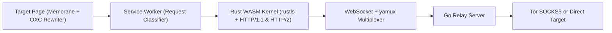

# ZeroProxy

Most web proxies force an uncomfortable trade-off. Server-side proxies decrypt your traffic on a remote machine and break modern JavaScript applications. Browser extensions require installation permissions and still share the browser's underlying networking stack and storage.

ZeroProxy takes a different path. Open a normal browser tab, point it at the ZeroProxy launcher, and browse any website inside a self-contained virtual environment. You do not need to install an extension or configure system-wide network settings. Every page runs inside a client-side JavaScript membrane that isolates cookies, storage, and DOM access per target site, while a WebAssembly transport kernel inside the Service Worker handles TLS encryption and HTTP framing directly in your browser. The Go server only forwards encrypted byte streams to your chosen transport, such as Tor with per-tab stream isolation or a local development connection.

> [!NOTE]
> Website compatibility refactoring is in progress; this repository is a working prototype rather than a finished production release. Current scope, known limitations, and active engineering tracks live in the [website compatibility refactor plan](.ai/design/website-compat-refactor.md).

## How It Works

When you open a website through ZeroProxy, your browser and the local relay divide responsibilities so that page state and TLS sessions stay on the client.



1. **You enter a URL in the launcher.** ZeroProxy encrypts the target address into a route like `/zp/p/<encrypted>#k=<key>&server=...`. Because the decryption key lives in the URL `#` fragment, the browser never sends that key to the server over HTTP.
2. **The Service Worker intercepts every request.** Before a page loads, the Service Worker fetches the target response through the Rust WebAssembly kernel. The kernel establishes a TLS session with `rustls` and speaks HTTP/1.1 or HTTP/2 over a multiplexed `yamux` WebSocket tunnel to the Go relay.
3. **HTML, CSS, and scripts are transformed before execution.** The Rust HTML and CSS transformers rewrite static links and stylesheets, while the OXC AST rewriter transforms JavaScript so accesses to `window`, `location`, `document`, and dynamic code evaluation route through the virtual membrane.
4. **Each site gets its own isolated storage and network path.** The runtime membrane partitions `localStorage`, `sessionStorage`, IndexedDB, Cache Storage, and cookies by target origin. When paired with Tor, each tab authenticates to the SOCKS5 listener with separate credentials so tabs do not share Tor circuits.

## Quickstart

You can build and run ZeroProxy locally to test website compatibility or browse through a local Tor daemon.

### Prerequisites

Install the following tools before building from source:

- **Rust** with the `wasm32-unknown-unknown` target defined in [`rust-toolchain.toml`](rust-toolchain.toml).
- **`wasm-bindgen-cli`** matching the `wasm-bindgen` version pinned in [`Cargo.lock`](Cargo.lock).
- **Go** matching [`go.mod`](go.mod), **Node.js LTS**, and **npm**.
- **A modern Chromium or Firefox browser** with Service Worker and WebAssembly support.
- **Tor** (optional), required only when you want anonymous egress and per-tab stream isolation.

### 1. Build the Server and Browser Assets

> [!WARNING]
> Confirm that Rust, `wasm-bindgen-cli`, and Go are installed before running `npm run build` on a machine that already has a working `dist/` directory. The build script cleans `dist/` before compiling and will remove your runnable bundle if a required compiler is missing.

Run the build from the repository root:

```sh
npm ci
npm run build
```

This step compiles the Go server binary and the WebAssembly bundles into `dist/`:

```text
dist/zeroproxy-server                  Go relay server (.exe on Windows)
dist/web/                              Built browser assets served to clients
dist/web/__zp/zp_bundle_sw_bg.wasm     Service Worker HTML/CSS/JS rewrite bundle
dist/web/__zp/zp_kernel_sw_bg.wasm     Lazily loaded transport kernel (yamux, SOCKS5, rustls, HTTP)
dist/web/__zp/zp_page_bundle_bg.wasm   Page-realm dynamic script rewriter
dist/web/__zp/zp_page_rt.wasm          Raw WASM runtime for synchronous URL policy checks
```

### 2. Start the Relay Server

Choose either local test mode (no Tor required) or Tor mode.

> [!CAUTION]
> Do not use `-socks internal` when you need network anonymity. In internal mode, the Go relay dials target servers directly from your machine's IP address. Use an external Tor SOCKS5 listener with `IsolateSOCKSAuth` whenever anonymity matters.

> [!IMPORTANT]
> Always pass `-web dist/web` to the server. Passing the source `-web web` directory causes HTTP `503` errors because the compiled WebAssembly bundles only exist under `dist/web/`.

**Option A: Local compatibility test mode (direct connection, no Tor)**

```sh
./dist/zeroproxy-server -web dist/web -addr :8080 -socks internal
```

**Option B: Anonymous browsing through Tor**

Start a local Tor SOCKS5 listener with stream isolation enabled:

```sh
mkdir -p /tmp/zeroproxy-tor
tor --SocksPort "127.0.0.1:9050 IsolateSOCKSAuth" --DataDirectory /tmp/zeroproxy-tor
```

Once Tor prints `Bootstrapped 100% (done)`, start the ZeroProxy relay:

```sh
./dist/zeroproxy-server -web dist/web -addr :8080 -socks 127.0.0.1:9050
```

### 3. Open the Launcher

Open **`http://proxy.localhost:8080/zp/`** in your browser, type a destination URL, and press **Open**. Starting from `proxy.localhost` keeps the launcher, the Service Worker, and all encrypted target routes on a single secure context origin.

## Core Security Guarantees

ZeroProxy enforces four isolation rules so untrusted websites cannot break out of their virtual tab or leak your real network identity:

- **No direct network egress:** Target pages cannot open native connections to external servers. Content Security Policy headers and membrane hooks force all HTTP fetches, XMLHttpRequests, WebSockets, beacons, and subresources through the Service Worker and relay tunnel. Optional WebTransport and WebRTC TURN relays are disabled by default and require explicit server flags in [`cmd/zeroproxy-server/main.go`](cmd/zeroproxy-server/main.go).
- **No access to the real browser realm:** Target scripts never receive the real `window`, `Location`, or an uncontained iframe realm. Cross-origin frames and popups receive filtered handles that enforce HTML cross-origin security rules across virtual origins.
- **Strict per-site storage partitioning:** Even though every proxied tab shares the physical `proxy.localhost` origin in the browser, the membrane isolates cookies, `localStorage`, `sessionStorage`, IndexedDB, Cache Storage, BroadcastChannel, and Origin Private File System directories by target origin.
- **Fail-closed script and HTML transformation:** Every executable script passes through the Rust OXC parser and AST rewriter before running. If a script or HTML document cannot be rewritten safely, ZeroProxy blocks execution and renders an isolated error page instead of running untransformed code.
- **Client-held URL keys:** Target URLs are encrypted with AES-256-CBC and authenticated with HMAC-SHA256 using HKDF-derived keys. The decryption key stays in the URL `#` fragment on the client.

## Verification and Testing Commands

On machines with limited RAM, prefer pushing branches to the [GitHub Actions CI workflow](.github/workflows/ci.yml) rather than running parallel local Rust builds and headless browsers. When running checks locally, use the following commands:

| Check | Command | What It Verifies |
| :--- | :--- | :--- |
| **JavaScript unit and policy suite** | `npm run test:js` | Fast Node.js checks for URL policy, Service Worker routing, and membrane contracts without starting a browser. |
| **Rust workspace tests** | `cargo test --workspace` | Unit and property tests for OXC AST rewriting, HTML/CSS transforms, share URL encryption, and transport codecs. |
| **Go server and host tests** | `go test ./...` | Relay bridging, SOCKS5 framing, HTTP host handlers, CSP headers, and TURN/WebTransport gateways. |
| **WASM bundle integration** | `npm run test:wasm:ci` | Contract checks against prebuilt WebAssembly artifacts in `dist/`. |
| **Browser end-to-end suite** | `npm run test:e2e:ci` | Real Chromium E2E tests against `dist/`, including the E1 containment escape matrix and native-vs-proxy differential checks. |
| **TLS ClientHello check** | `npm run check:chrome-hello` | Verifies that the Rust kernel's TLS ClientHello matches the installed Chrome browser's extension set and `trust_anchors` payload. |
| **Real-site smoke test (opt-in)** | `npm run dogfood:real-site` | Launches a fresh Chromium profile and loads live external sites through the proxy ([`test/e2e/real-site-regression.test.js`](test/e2e/real-site-regression.test.js)). |

## Repository Map

The codebase splits responsibilities across Rust (compiled to WebAssembly), JavaScript (Service Worker and page membrane), and Go (the local relay server):

| Path | Responsibility |
| :--- | :--- |
| [`Cargo.toml`](Cargo.toml) | Rust workspace configuration and shared dependency pins. |
| [`crates/zp-engine`](crates/zp-engine) | Unified Rust facade over script rewriting, streaming HTML transformation, CSS rewriting, and source map composition. |
| [`crates/zp-bundle`](crates/zp-bundle) | Service Worker WebAssembly exports wrapping `zp-engine` and shared policy helpers. |
| [`crates/zp-kernel-bundle`](crates/zp-kernel-bundle) | Lazily loaded browser transport kernel (`yamux`, SOCKS5, `rustls`, HTTP/1.1, HTTP/2, and target WebSockets). |
| [`crates/zp-rewriter`](crates/zp-rewriter), [`crates/zp-htmltx`](crates/zp-htmltx), [`crates/zp-css`](crates/zp-css) | OXC JavaScript AST rewriter, streaming `lol_html` HTML transformer, and SWC CSS URL rewriter. |
| [`crates/zp-shared`](crates/zp-shared), [`crates/zp-transport-codec`](crates/zp-transport-codec) | CSP builders, share URL encryption, error codes, and SOCKS5/HTTP/1.1 wire codecs. |
| [`crates/zp-page-bundle`](crates/zp-page-bundle), [`crates/zp-page-rt`](crates/zp-page-rt), [`web/zp-rt.js`](web/zp-rt.js) | Slim page-realm script rewriter and synchronous raw-WASM URL policy runtime. |
| [`web/index.html`](web/index.html), [`web/zp-core.js`](web/zp-core.js) | Browser launcher UI, route constants, binary fetch envelope codec, and shared URL helpers. |
| [`web/sw.js`](web/sw.js) | Service Worker entry point for request classification, tab context, rewrite caching, and kernel dispatch. |
| [`web/membrane/`](web/membrane), [`web/runtime-prelude.js`](web/runtime-prelude.js), [`web/worker-prelude.js`](web/worker-prelude.js) | Virtual browser membrane modules for page and worker realms. |
| [`cmd/zeroproxy-server`](cmd/zeroproxy-server), [`internal/`](internal) | Go CLI entry point, embeddable `internal/httphost` handler, WebSocket relay, and optional WebTransport/TURN gateways. |
| [`scripts/build.mjs`](scripts/build.mjs), [`scripts/test.mjs`](scripts/test.mjs) | Cross-language build pipeline and test runner scripts. |
| [`test/js`](test/js), [`test/e2e`](test/e2e), [`test/browser`](test/browser) | Node contract tests, Puppeteer E2E suites, and interactive browser diagnostic runners. |

## Documentation Index

Use the documents below to explore ZeroProxy's architecture, security status, operational procedures, and debugging workflows:

| Document | Scope |
| :--- | :--- |
| [`CLAUDE.md`](CLAUDE.md) | Architecture overview, crate responsibilities, build and test commands, and contributor workflow rules. |
| [`AGENTS.md`](AGENTS.md) | Code quality and documentation standards for contributors and automated agents. |
| [`PRODUCTION_ROLLOUT.md`](PRODUCTION_ROLLOUT.md) | Operator dogfood checklist, runtime monitoring signals, and rollback procedure. |
| [`REFACTOR.md`](REFACTOR.md) | Component boundaries and embedding interfaces (`zp-engine`, `Dialer`, membrane bridge, and `internal/httphost`). |
| [`PHASE2_STATUS.md`](PHASE2_STATUS.md) | Subsystem verification matrix, security gate evidence, and intentional compatibility trade-offs. |
| [`ERRATA.md`](ERRATA.md) | Catalog of resolved containment and compatibility defects alongside open residuals. |
| [`HANDOFF.md`](HANDOFF.md) | Current engineering scope, real-site compatibility status, and browser diagnostic workflows. |
| [`.ai/design/website-compat-refactor.md`](.ai/design/website-compat-refactor.md) | Website compatibility design, responsibility boundaries, and active refactor tracks. |
| [`.ai/trap-notebook/README.md`](.ai/trap-notebook/README.md) & [`.ai/trap-notebook/INDEX.md`](.ai/trap-notebook/INDEX.md) | Indexed reference of subtle browser, AST rewriter, Service Worker, and TLS traps. |
| [`test/browser/README.md`](test/browser/README.md) | Cross-site browser diagnostic probes covering isolation, fidelity, console noise, and prototype shapes. |
| [`test/browser/hole-matrix/README.md`](test/browser/hole-matrix/README.md) | Containment escape matrix runner and two-axis verdict classifier for subresource URLs. |
